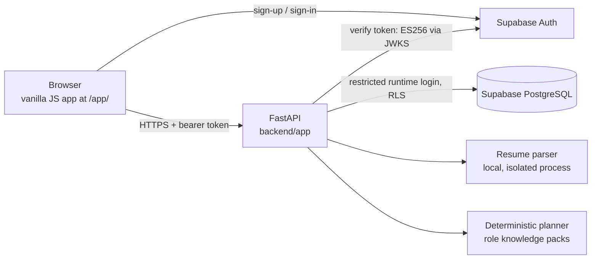

# Trace

**Find your path to your target role.** Upload your resume. Choose your target. See your path.

Trace helps people plan a move into or within product management. It reads your resume, lets you check and correct
everything it found, and compares your confirmed experience with sourced descriptions of what each product role
involves. It then shows where you stand, the routes to your target role and what to build next. Every judgement points
back to the lines of your own experience that support it.

## The problem

A career move is hard to plan from the inside. It's hard to tell whether your experience is enough, what's missing, how
soon you could move, or what to do next. Job descriptions, other people's profiles and scattered advice rarely add up
to a connected view of your own position.

## Who it's for

- **Professionals moving into product management**, from engineering, QA, analysis, consulting, design or another field.
- **Product Managers aiming higher**, towards senior or lead roles.
- **People making a lateral move**: the same kind of role at another company, or in another kind of product.

## What Trace does

| Step | What happens |
|---|---|
| Upload | A PDF or Word resume is read on Trace's own server, in memory. The file isn't kept, and it isn't sent to any AI or other service. |
| Review | Everything Trace found is shown as a private draft. You correct, add or remove anything, then confirm once. Nothing reaches your profile before that. |
| Target | Choose any product role, including the one you have now (for a move to another company), and optionally where you'd like to move and by when. |
| Plan | Where your experience stands against the target's capabilities (evidence found / needs more context / not yet demonstrated), the recommended route and the alternatives considered, and specific next actions with what to keep as evidence. |
| Control | Update your profile from a new resume (it replaces the old one only when you confirm), or clear your career profile and start over. |

Trace keeps three things apart and labels each one: **your private profile**, **career research** (aggregated, never
individual) and **Trace's recommendations**.

## Architecture



| Part | Role |
|---|---|
| **FastAPI** (`backend/app`) | Thin API routes over services. The backend decides everything (counts, labels, ranking); the browser only renders. |
| **Supabase Auth** | Email and password accounts. The API verifies every access token itself. |
| **Supabase PostgreSQL** (`data-foundation`) | Additive, versioned migrations with rollback scripts and pgTAP tests. Row Level Security on every private table; the API connects as a restricted login that can't bypass RLS or own tables. |
| **Resume parsing** (`backend/app/services/resume_parsing`) | Local PDF/DOCX extraction and de-identification. No external AI or parsing service. |
| **Candidate profile and evidence** | The user's reviewed jobs, experience lines, education, skills and corrections, with provenance and an append-only correction history. |
| **Capability reading** (`backend/app/services/capability`) | A deterministic reading of confirmed lines against the target role's sourced capability requirements, with the exact words relied on. |
| **Career pathway planning** (`backend/app/services/transition`) | Routes, readiness and next actions from versioned role knowledge packs (`data-foundation/knowledge_packs`). |
| **Career Origins research** | An aggregated research view of how Product Managers with different backgrounds moved. **Not included in this repository and switched off in production** while its data-use and privacy review is completed. |

Embeddings, when switched on, stay inside Trace (local gte-small, pgvector). A demo narrative can be written by an
OpenAI-compatible model configured with environment variables. That path is off unless `TRACE_AI_ASSESSMENT=1`.
Nothing in the production deploy config turns it on. See [DEMO.md](DEMO.md).

## Data and privacy

- The original resume file is never stored. Trace keeps its size, type and a fingerprint.
- Before confirmation, a private draft with name, email, phone and links removed. After confirmation, the profile.
- Profiles, plans and drafts are visible only to their owner, enforced by RLS in the database and tested across users.
- Users can replace their profile from a new resume (in one transaction), or clear it. Clearing deletes their career
  details, plans, drafts and upload records and keeps their account.
- Automated tests use synthetic, fictional resumes and profiles only.
- Career research, when enabled, shows aggregates only: small groups are hidden or banded, and it describes observed
  histories without predicting anyone's chances.

## Run it locally

Requires Python 3.12, Docker and the Supabase CLI.

```sh
cd data-foundation && supabase start            # local Supabase with all migrations
cd ../backend && python3.12 -m venv .venv && .venv/bin/pip install -r requirements-dev.txt
cp .env.example .env                            # local URLs and keys from `supabase status`
.venv/bin/python -m scripts.provision_runtime_role
SUPABASE_SERVICE_ROLE_KEY=... TRACE_DEMO_PASSWORD=... .venv/bin/python -m scripts.demo_setup --users 1
                                                # local only: installs the local notices and a demo account
.venv/bin/python -m uvicorn app.main:app --port 8000   # open http://127.0.0.1:8000/app/
```

Tests:

```sh
cd backend && .venv/bin/python -m pytest -q                 # needs the local Supabase stack
cd data-foundation && supabase test db --local              # pgTAP
cd data-foundation && ../backend/.venv/bin/python -m pytest -q
```

## Deployment

The production service is on Fly.io (`Dockerfile`, `fly.toml`, region `nrt`) with a dedicated Supabase project.
A preview can be run on Cloud Run in `asia-south1`. Neither is changed by a pull request. Secrets stay in the
platform's secret store. See [docs/DEPLOYMENT.md](docs/DEPLOYMENT.md). Do not point a preview at the production database.

## Demo flow

Use a fictional resume. The steps, the model environment variables, and the preview deploy are in [DEMO.md](DEMO.md).

1. Open the landing page and create an account (confirm your email, or use the local demo account).
2. Agree to resume reading and upload a PDF or Word resume. The file is not kept.
3. Review and correct what Trace found, then confirm. A year is enough for education when the resume has no month.
4. Choose a target. Associate Product Manager, Product Manager and Senior Product Manager produce a plan. Other moves on that ladder are labelled Limited support.
5. Read what the experience proves, what is still open, and the next step. When the model is configured, that reading cites the lines it used.
6. From Profile settings, download your data as JSON, or delete the account. Clearing the career profile keeps the account.

## Current limitations

- The assessed moves are into Associate Product Manager or Product Manager, from Associate to Product Manager, and from Product Manager to Senior Product Manager. Other moves are labelled Limited support. Roles outside that ladder are not guessed at.
- The capability reading is deterministic. On wording it hasn't seen, it misses evidence (a missed line shows as "needs
  more context", not as a false claim). Its evaluation set is author-annotated.
- The career research view is off outside an authorised local preview, and its data isn't in this repository.
- Account deletion is in Profile settings (`POST /api/v1/account`). It needs migration v2.36.0 on the database it talks to. Clearing the career profile still keeps the account.
- No licence has been chosen yet, so all rights are reserved.

Design decisions are recorded in [docs/DECISIONS.md](docs/DECISIONS.md) and the phase plan in
[docs/IMPLEMENTATION_PLAN.md](docs/IMPLEMENTATION_PLAN.md).
