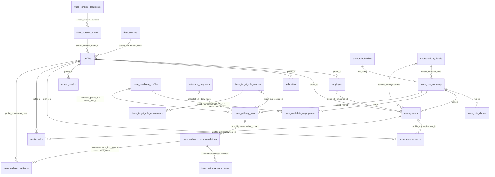
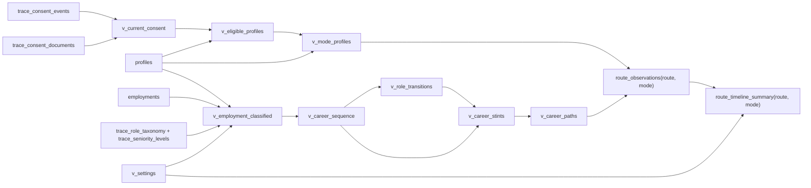

# Trace database schema map (for the backend)

This map covers the parts of the Trace Data Foundation v2.0.2 that matter for career-pathway recommendations.

**Sources**
- The migrations in `data-foundation/supabase/migrations/` (11 files, `20261111120000` to `20261111121000`).
- `data-foundation/docs/DATA_DICTIONARY.md`.
- Read-only queries against the local Supabase Postgres 17.11 database on 2026-11-11.

**Authority.** The data foundation is authoritative. If this map and the migrations disagree, the migrations win. Never edit anything in `data-foundation/` from the backend.

---

## 1. State of the local database (2026-11-11)

| Fact | Value |
|---|---|
| Migrations applied (`supabase_migrations.schema_migrations`) | All 11, matching the files in the repo |
| `trace_ref.profiles` | 41 rows, all `synthetic_test_fixture` / `synthetic_curated` / `synthetic_demo_allowed = true` |
| `trace_ref.employments` / `employers` / `experience_evidence` / `profile_skills` | 106 / 83 / 106 / 174 |
| `public.trace_consent_documents`, `trace_consent_events` | 0 / 0 (no consent text approved yet) |
| `trace_ref.v_eligible_profiles` | **0 rows**: no empirical data exists |
| `trace_ref.v_mode_profiles` | `synthetic_test` 41, `synthetic_demo` 41, `empirical` 0 |
| `trace_ref.v_role_transitions` | 63 (55 `confirmed`, 8 `unconfirmed`) |
| `trace_ref.v_career_paths` | 45 segments |
| Candidate and pathway tables (`public.trace_candidate_*`, `trace_pathway_*`, `trace_target_role_*`) | All empty |
| Lookups | 34 roles, 106 role aliases (20 context-required), 15 seniority levels, 21 role families, 126 skills, 16 responsibility areas |
| `trace_ref.analytics_settings` | `min_profiles_limited` 5, `min_profiles_moderate` 15, `min_profiles_strong` 40, `min_dated_profiles_for_timeline` 20, `min_mapping_confidence` 0.8 |

**What this means for the backend.** Every empirical query currently returns zero rows or `insufficient`. For example, `route_timeline_summary(['PM-APM','PM-PM'], 'empirical')` returns `supporting_profile_count = 0`. The same call in `synthetic_test` mode returns 13 supporting profiles, but always with the evidence class `synthetic_test_only`. Develop against the `synthetic_test` mode. The engine must handle an empty empirical cohort as a normal, expected result.

---

## 2. Schemas

| Schema | Exposed through the Supabase Data API? | Contents | Who can access it |
|---|---|---|---|
| `public` | Yes (`config.toml`: `schemas = ["public", "graphql_public"]`) | `trace_*` tables: lookups, consent, the signed-in user's career history, pathway outputs, agent threads | RLS on every table. Clients use `anon`/`authenticated`; the backend uses `service_role` |
| `trace_ref` | **No. It must never be exposed** | The de-identified reference cohort, the consent-aware analytics views, settings, snapshots and the audit log | `service_role` only. RLS is enabled with no policies |
| `trace_util` | No | Immutable date and array helpers, and trigger functions | `authenticated` and `service_role` may execute the helpers. The trigger functions are `security definer` |
| `storage` | Supabase-managed | The private `trace-resumes` bucket | Owner-folder policies |

**Enumerated types** (all in `public`):

| Type | Values |
|---|---|
| `trace_dataset_class` | `consented_real_reference`, `uploaded_resume_fixture` (forbidden in this database), `synthetic_test_fixture`, `public_aggregate_reference` |
| `trace_data_mode` | `empirical`, `synthetic_test`, `synthetic_demo` |
| `trace_consent_purpose` | `resume_processing`, `deidentified_shared_dataset`, `external_demo`, `model_provider_processing`, `product_research` |
| `trace_consent_status` | `granted`, `denied`, `withdrawn` |
| `trace_date_precision` | `month`, `year`, `unknown`, `ongoing` (`ongoing` is valid for end dates only) |
| `trace_employment_type` | `full_time`, `part_time`, `contract`, `internship`, `apprenticeship`, `freelance`, `founder`, `volunteer`, `unknown` |
| `trace_mapping_status` | `confirmed`, `auto_high_confidence`, `needs_review`, `unresolved` |
| `trace_review_status` | `extracted_unverified`, `participant_confirmed`, `reviewer_confirmed`, `synthetic_curated`, `rejected` |
| `trace_evidence_status` | `extracted_unverified`, `participant_confirmed`, `document_verified`, `synthetic_curated`, `rejected` |
| `trace_evidence_class` | `strong`, `moderate`, `limited`, `insufficient`, `synthetic_test_only` |

---

## 3. Relationship diagram

Tables without a `trace_` prefix are in `trace_ref`; tables with the prefix are in `public`. Only relationships that matter for pathways are shown.

Analytics view pipeline (all views are in `trace_ref` and use `security_invoker = true`):

---

## 4. Reference profiles and consent eligibility

### `trace_ref.profiles`
| Column | Type | Notes |
|---|---|---|
| `profile_id` | `text` PK | Matches `^[A-Z]{3}-[0-9]{3,}$`. Synthetic profiles must start with `SYN-` |
| `source_id`, `dataset_class` | `text`, `trace_dataset_class` | Composite FK to `data_sources(source_id, dataset_class)`. `unique (profile_id, dataset_class)` lets other tables carry the class alongside the id |
| `review_status` | `trace_review_status` | Synthetic profiles must be `synthetic_curated` (and only synthetic profiles may be) |
| `synthetic_demo_allowed` | `boolean` | May be true only for synthetic profiles |
| `contributor_user_id` | `uuid` → `auth.users` (on delete set null) | Real profiles only. A pseudonymous link used to honour withdrawal. Never return it to clients |
| `source_consent_event_id` | `uuid` → `trace_consent_events` (on delete set null) | Real profiles only |
| `resume_as_of_{year,month,precision}`, `resume_as_of_lo/hi` | `int`, enum, generated `int` | Used to cap the tenure of ongoing roles |
| `country_code`, `region_group`, `scenario_code`, `test_tags`, `data_quality_flags` | | Descriptive |

**Constraints:**
- `uploaded_resume_fixture` is rejected.
- `profiles_contributor_only_real`: the contributor and consent links are allowed only on `consented_real_reference` profiles.
- The trigger `enforce_consent_integrity` runs on writes. A real profile must point to a **granted** `deidentified_shared_dataset` event belonging to the same contributor.

### Consent
- **`public.trace_consent_documents`.** PK `(consent_version, purpose)`. `legal_review_status` is `draft_not_reviewed`, `approved` or `retired`. A grant is effective only when its document is `approved`. No documents exist yet.
- **`public.trace_consent_events`.** An append-only log; an update trigger raises an error. PK `consent_event_id uuid`. Other columns: `user_id` → `auth.users` (on delete cascade), `purpose`, `status`, `consent_version`, `recorded_at`.
- **`trace_ref.v_current_consent`.** The latest event per `(user_id, purpose)`. Its `is_active` column is `status = 'granted' AND document approved`.

### `trace_ref.v_eligible_profiles`: the only entry point for empirical analytics
A profile is eligible only when **all** of these hold:
1. `dataset_class = 'consented_real_reference'`;
2. `source_consent_event_id IS NOT NULL`;
3. `review_status IN ('participant_confirmed', 'reviewer_confirmed')`;
4. the contributor's **current** `deidentified_shared_dataset` consent is active (granted, under an approved document).

Rule 4 is evaluated on every read, so a withdrawal removes the profile immediately.

### Related views
- **`v_mode_profiles(data_mode, profile_id)`** says which profiles each mode may read:
  - `empirical`: `v_eligible_profiles`;
  - `synthetic_test`: all synthetic fixtures;
  - `synthetic_demo`: synthetic fixtures with `synthetic_demo_allowed`.
- **`v_demo_eligible_profiles`** lists profiles that may appear in demos. A synthetic profile needs the demo flag. A real profile needs empirical eligibility plus an active `external_demo` consent.

---

## 5. Employment records and how they connect to a profile

### `trace_ref.employments`
| Column | Type | Notes |
|---|---|---|
| `employment_id` | `text` PK | Must match `<profile_id>-EMP-%` |
| `profile_id` | `text` → `profiles` (on delete cascade) | |
| `sequence_index` | `int ≥ 1` | `unique (profile_id, sequence_index)`, **deferrable initially deferred** so a profile can be re-sequenced inside one transaction. Defines career order |
| `employer_id` | `text` | Composite FK `(profile_id, employer_id)` → `employers`. Employer tokens are scoped to one profile (`<profile_id>-ORG-%`) and are never shared across profiles |
| `title_raw_redacted` | `text` | |
| `role_id` | `text` → `trace_role_taxonomy` | `role_family` is **not stored** here; derive it from the taxonomy |
| `seniority_code` | `text` → `trace_seniority_levels`, nullable | Null means use the taxonomy's `default_seniority_code` |
| `mapping_status`, `mapping_confidence` | enum, `numeric(4,3)` | `unresolved` requires `role_id = 'ROLE-UNKNOWN'`. `ROLE-UNKNOWN` requires `unresolved` or `needs_review` |
| `employment_type` | `trace_employment_type` | |
| `primary_career_sequence` | `bool` | `false` marks parallel activity, which sits outside the chain (live: `SYN-034-EMP-02`, `SYN-039-EMP-02`) |
| `counts_as_full_time_experience`, `classification_note` | `bool` nullable, `text` | Null means derive the value from `employment_type`. An explicit value requires a note |
| `start_*`, `end_*`, `*_precision` | `int`, `int`, enum | Partial dates |
| `start_lo/hi`, `end_lo/hi` | generated `int` | Month index = `year*12 + (month-1)`. A year-only date spans `[Jan, Dec]`. Unknown dates are `NULL` |
| `is_current_as_stated` | `bool` | Must equal `end_precision = 'ongoing'` |
| `extraction_status`, `data_quality_flags` | | |

Child tables keyed by `profile_id`:
- `employers` (industry, company model, size band);
- `education`;
- `career_breaks`;
- `experience_evidence` (responsibility areas);
- `profile_skills`.

Evidence and skills attach to an employment through the composite key `(profile_id, employment_id)`, so they cannot cross profiles.

### Profile → transitions chain

1. **`v_employment_classified`** (one row per employment).
   - Adds `role_family`, `is_pm_target`, the effective `seniority_code` and `seniority_rank`, the effective `counts_as_full_time_experience`, and `tenure_months_min/max`. Ongoing tenure is capped at `resume_as_of`, with `tenure_is_censored` set.
   - Adds **`exclusion_reasons text[]`**, which can contain `parallel_activity`, `not_full_time_experience`, `unresolved_role`, `mapping_not_confirmed`, `low_mapping_confidence` (`< min_mapping_confidence`) and `unknown_start_date`.
2. **`v_career_sequence`** keeps every *primary* record, including ineligible ones, in `sequence_index` order. It adds `is_transition_eligible` (no exclusion reasons), `primary_position` and `prev_employment_id`.
3. **`v_role_transitions`** (one row per consecutive primary pair):
   - `from_/to_employment_id`, `from_/to_role_id`, `from_/to_role_family`;
   - `move_type`: `internal` (same employer token), `external` or `unknown`;
   - `seniority_rank_change`: null if either rank is null (founder or unknown);
   - `timing_relation`, `gap_months_min/max` and `gap_is_precise`;
   - `unconfirmed_reasons text[]`: prefixed `from:`, `to:` or `timing:`;
   - **`transition_status`**: `confirmed` or `unconfirmed`.
4. **`v_career_stints`** splits a profile into *segments*: maximal runs of records joined by confirmed transitions. Inside a segment, consecutive eligible records with the same role collapse into one stint.
5. **`v_career_paths`** gives one row per `(profile_id, segment_no)` with `role_path text[]` and `stint_start_lo/hi int[]`. Live example: `SYN-001` has the path `{ROLE-SWE, PM-APM, PM-PM}`.

**Other related views:**
- **`v_profile_sequence_integrity`** flags sequence gaps, order conflicts and multiple ongoing primary roles. All three counts are 0 live.
- **`v_career_timeline`** merges employment, education and career breaks for review screens.

---

## 6. Role taxonomy, aliases and seniority

| Table | Key columns | Notes |
|---|---|---|
| `public.trace_seniority_levels` | `seniority_code` PK, `rank smallint unique` (nullable) | Ranks run from intern 10 to executive 100. `founder` and `unknown` have no rank and are never compared |
| `public.trace_role_families` | `role_family` PK, `is_product_management` | 21 families. Only `product_management` is product management |
| `public.trace_role_taxonomy` | `role_id` PK (`^(PM\|ROLE)-[A-Z0-9]+$`), `role_family` FK, `default_seniority_code` FK, `is_pm_target`, `is_resolved`, `active` | CHECKs: a PM target must be in `product_management`; an unresolved role cannot be a target. Retire roles with `active = false`; never delete them |
| `public.trace_role_aliases` | `alias_id` PK, `alias_normalized` (generated: lowercased, whitespace collapsed), `role_id` FK, `seniority_hint_code`, `context_required`, `default_confidence`, `mapping_rule` | `unique (alias_normalized, role_id)`, so **one alias can map to several roles**. Those aliases must be `context_required` and carry a `mapping_rule`. A context-required match is stored as `needs_review` and is never auto-confirmed |

**Targets (`is_pm_target = true`).** These 9 roles are valid targets: `PM-APM`, `PM-PM`, `PM-SPM`, `PM-LEAD`, `PM-PRINCIPAL`, `PM-GPM`, `PM-HEAD`, `PM-DIR`, `PM-SDIR`.

**Product management roles that are not targets:** `PM-INTERN`, `PM-VP`, `PM-CPO`.

**Notable non-PM roles:**
- `ROLE-OWNER` (Product Owner) is in the separate `product_ownership` family, so `ROLE-OWNER → PM-PM` is a real cross-family move.
- `ROLE-UNKNOWN` (`is_resolved = false`) keeps unresolved titles in the sequence. Because they stay in place, they break chains.

Clients (`anon` and `authenticated`) may read all of these lookups, so they can be cached in the backend.

---

## 7. Transitions: confirmation and date precision

A transition is **`confirmed`** only when both of these hold:
- neither end has any `exclusion_reasons`; and
- `timing_relation` is `sequential` or `same_month_boundary`.

Otherwise it is **`unconfirmed`**, and every reason is listed in `unconfirmed_reasons`.

| `timing_relation` | Meaning | Confirmable? |
|---|---|---|
| `sequential` | The next role starts after the previous one's latest possible end | Yes |
| `same_month_boundary` | Both dates are month-precise and fall in the same month | Yes |
| `previous_role_ongoing` | The previous role's end date is `ongoing` | No |
| `timing_unknown` | A needed date is unknown | No |
| `sequence_order_conflict` | The next role starts before the previous one started | No |
| `overlapping` | The roles overlap by more than the shared boundary month | No |
| `boundary_uncertain` | Order can't be established, e.g. a year-only end and start in the same year | No |

**Precision.**
- `gap_months_min/max` bound the gap between roles. `gap_is_precise` is true only when both boundary dates are month-precise.
- In route timelines, an observation is `is_precise` only when the first and last stint starts are month-precise. Only precise observations feed the percentiles.
- Year-only observations contribute only to `coarse_min_months` and `coarse_max_months`.

**Key rule.** A → unknown → B produces **two unconfirmed transitions, never A → B**. Records are excluded *after* pairing, so an excluded record breaks the chain instead of being skipped over.

Live distribution of `timing_relation`: `sequential` 57, `same_month_boundary` 2, `timing_unknown` 2, `overlapping` 1, `boundary_uncertain` 1.

---

## 8. Target roles and pathway tables

All of these are in `public` and are empty today. The backend writes them as `service_role`; the owner reads them through RLS.

| Table | PK / key FKs | Important rules |
|---|---|---|
| `trace_target_role_sources` | `target_role_source_id uuid` PK; `role_id` → taxonomy | `source_url` must be `https://`. `source_status` is `current`, `current_check_required`, `expired` or `withdrawn`. Clients never see withdrawn sources |
| `trace_target_role_requirements` | `requirement_id` PK; `target_role_source_id` FK (cascade); `skill_id`, `responsibility_area` FKs | A `requirement_type = 'skill'` row requires a `skill_id` |
| `trace_pathway_runs` | `pathway_run_id` PK; `(candidate_profile_id, owner_user_id)` → candidate profile; `target_role_id` → taxonomy; `(reference_snapshot_id, data_mode)` → `trace_ref.reference_snapshots` | `status = 'completed'` **requires** a `reference_snapshot_id`, and the snapshot must have the same `data_mode`. `unique (pathway_run_id, owner_user_id, data_mode)` |
| `trace_ref.reference_snapshots` | `snapshot_id` PK, `data_mode`, `settings jsonb`, `eligible_profile_count`, `confirmed_transition_count` | Freezes the settings and cohort size used by a set of runs. Create one before completing a run |
| `trace_pathway_recommendations` | `recommendation_id` PK; FK `(pathway_run_id, owner_user_id, data_mode)` → run | `unique (pathway_run_id, rank)`. See the constraints below |
| `trace_pathway_route_steps` | PK `(recommendation_id, step_index)`; `role_id` → taxonomy | Ordered roles in the recommended route |
| `trace_pathway_evidence` | `pathway_evidence_id` PK; FK `(recommendation_id, owner_user_id, data_mode)`; FK `(reference_profile_id, reference_dataset_class)` → `trace_ref.profiles` (on delete set null) | `reference_profile_id` and `reference_dataset_class` are **not granted** to clients |

**Constraints on recommendations and evidence.** The CHECKs and triggers fail closed.
- `data_mode = 'empirical'` ⇔ `evidence_class <> 'synthetic_test_only'`.
- A non-empirical run can never set `timeline_display_allowed`.
- The percentiles `p25_months`, `median_months` and `p75_months` must be all null or all set and ordered. Setting them requires `timeline_metric = 'route_start_to_target_start_months'`.
- The trigger `enforce_thresholds` applies to empirical runs only:
  - `strong`, `moderate` and `limited` need `supporting_profile_count` of at least 40, 15 and 5 respectively;
  - a timeline or percentiles need `dated_profile_count ≥ 20`;
  - the trigger raises an error if any setting is missing.
- The trigger `enforce_evidence_eligibility` checks empirical evidence at insert/update time: its `reference_profile_id` must be in `v_eligible_profiles`.
- An empirical run may cite only `consented_real_reference` profiles; a synthetic run may cite only `synthetic_test_fixture` profiles.

**Candidate side.** The user's own history lives in:
- `trace_candidate_profiles` (PK `candidate_profile_id`, `owner_user_id`, `unique (candidate_profile_id, owner_user_id)`);
- `trace_candidate_employments`, which mirrors `employments` with uuid keys, `title_raw`, the same mapping, precision and date CHECKs, and `participant_confirmed`;
- `_employers`, `_education`, `_career_breaks`, `_evidence` and `_skills`.

Every child table uses the composite FK `(candidate_profile_id, owner_user_id)`, so a row can't attach to another user's profile. **No analytics views exist for candidate data.** To sequence a user's own history, either reimplement the same rules in Python or port `data-foundation/scripts/trace_model.py`, which is the reference implementation. Candidate data is never copied into `trace_ref` automatically.

---

## 9. What to query for empirical recommendations

| Need | Use | Notes |
|---|---|---|
| Cohort and evidence for a route | `trace_ref.route_timeline_summary(route text[], data_mode)` | Returns `supporting_profile_count`, `dated_profile_count`, `count_display_allowed`, `evidence_class`, the percentiles (null below the timeline threshold), the coarse range and `timeline_display_allowed`. Already mode-filtered and threshold-aware |
| Per-profile matches for a route | `trace_ref.route_observations(route text[], data_mode)` | One row per individual: their first match within one confirmed segment. The route is collapsed first (`{A,A,B}` → `{A,B}`) and must have **at least 2 roles** after collapsing |
| Which profiles a mode may read | `trace_ref.v_mode_profiles` | Join this onto any view you query directly |
| Empirical cohort | `trace_ref.v_eligible_profiles` | The **only** source of empirical profiles |
| Observed paths | `trace_ref.v_career_paths` **joined to `v_mode_profiles`** | For discovering candidate routes |
| Transition detail and counts | `trace_ref.v_role_transitions` **joined to `v_mode_profiles`** and filtered on `transition_status = 'confirmed'` | |
| Thresholds | `trace_ref.v_settings` | A missing `min_mapping_confidence` is treated as 1.0 |

> ⚠️ **The views are not mode-filtered.** `v_employment_classified`, `v_career_sequence`, `v_role_transitions`, `v_career_stints` and `v_career_paths` contain **every dataset class**, including synthetic. Only the two `route_*` functions apply `data_mode` themselves. Any direct query against these views must join `v_mode_profiles` on `profile_id` with an explicit `data_mode`. Without that join, synthetic rows will leak into empirical results.

The timeline metric is `route_start_to_target_start_months`, measured from people who **did** complete the route. It is not a success probability, and no probability may be derived from it.

---

## 10. Records that must be excluded, and why

| Excluded | How the database enforces it | Why |
|---|---|---|
| `uploaded_resume_fixture` (the 18 third-party resumes) | CHECK on `data_sources` and `profiles`: the class cannot be stored | The resume subjects never gave permission for shared reuse |
| Synthetic profiles in empirical analytics | `v_eligible_profiles` requires `consented_real_reference`. CHECKs on recommendations and evidence | Synthetic profiles are test fixtures, not observations of real careers |
| Real profiles without an active `deidentified_shared_dataset` consent (never granted, denied, withdrawn, or under an unapproved document) | `v_eligible_profiles` joins `v_current_consent.is_active` on every read | Consent is purpose-specific and revocable |
| Real profiles that aren't participant- or reviewer-confirmed | `v_eligible_profiles` filters on `review_status` | Unverified extractions aren't reliable evidence |
| Parallel activity (`primary_career_sequence = false`) | Left out of `v_career_sequence` | It isn't part of the linear career chain |
| Internships, freelance, founder, part-time, volunteer and unknown employment types (unless explicitly reclassified) | `not_full_time_experience` reason | They don't count as full-time experience by default |
| Unresolved roles, mappings that aren't confirmed, and mapping confidence below 0.8 | Exclusion reasons that make transitions unconfirmed | An uncertain role must not create a false transition |
| Unknown start dates; overlapping, ambiguous or ongoing timings | Exclusion and `timing:` reasons | Chronological order can't be established |
| Unconfirmed transitions | They break segments, so routes never span them | Prevents stitching A → B across an unknown role |
| Routes stitched across people | `route_observations` matches only within one individual's segment | Every observation must be real for one person |
| Withdrawn target-role sources | RLS on `trace_target_role_sources` and `trace_target_role_requirements` | Withdrawn sources must not be shown |

---

## 11. Permissions and constraints that affect the backend

1. **Connection role.**
   - The local `DATABASE_URL` connects as `postgres`, which has `BYPASSRLS` but is not a superuser.
   - `service_role` (also `BYPASSRLS`) is the role the design intends for backend data access. It has `SELECT` on all `trace_ref` tables and views, `EXECUTE` on the two `route_*` functions, and full rights on the `public.trace_*` tables.
   - `anon` and `authenticated` have **no** access to `trace_ref` (verified with `has_schema_privilege`).
2. **The backend bypasses RLS, so it must scope by owner itself.** For every per-user query, filter on `owner_user_id` explicitly.
3. **Never expose these to clients:**
   - `trace_ref` itself;
   - `contributor_user_id` and `source_consent_event_id`;
   - `trace_pathway_evidence.reference_profile_id` and `reference_dataset_class`;
   - the service-role key.

   Shown counts must respect `count_display_allowed`, which requires at least `min_profiles_limited` (5) supporting profiles.
4. **Views are `security_invoker`.** They run with the caller's privileges, so a role without `trace_ref` access gets an error rather than silently elevated access.
5. **Append-only tables.**
   - `trace_consent_events` and `trace_ref.access_log` reject `UPDATE`.
   - A correction or withdrawal is a new event.
   - Record reads and exports of reference data in `trace_ref.access_log`.
6. **Write order for a pathway run:**
   1. Insert `trace_pathway_runs` (`created`).
   2. Insert `trace_ref.reference_snapshots` in the same `data_mode`.
   3. Insert recommendations, then route steps and evidence.
   4. Set the run to `completed` with the snapshot id.
   The composite FKs carry `data_mode` from run → recommendation → evidence, so it cannot drift.
7. **Generated columns.** `*_lo/hi` and `alias_normalized` are generated, so never write them. Write the year, month and precision instead; the CHECKs validate partial dates (years 1950–2100) and feasible periods.
8. **Deferred uniqueness.** `(profile_id, sequence_index)` and `(candidate_profile_id, sequence_index)` are deferred until commit. Re-sequence a profile inside one transaction.
9. **Cascades.**
   - Deleting an `auth.users` row cascades to all of that user's candidate, consent and pathway rows. On real reference profiles, `contributor_user_id` is set to null.
   - Deleting a reference profile sets `trace_pathway_evidence.reference_profile_id` to null.
10. **Do not change the schema from the backend.** Any change ships as a new migration in the data foundation.

---

## 12. Open points for the pathway engine

- **No empirical data exists yet.** Real data needs an approved consent document, real contributions and a de-identification flow first. Until then, empirical results are always `insufficient`.
- **Candidate-side sequencing has no SQL views.** Decide whether to port `trace_model.py` or add views through a new data-foundation migration.
- **Withdrawal doesn't update stored evidence.** The evidence-eligibility trigger runs only at insert/update. Recommendations written before a contributor withdrew keep their evidence rows until a profile is deleted (then the FK sets the id to null) or the rows are regenerated. A refresh or expiry policy is needed.
- **Backend connection role.** Decide whether the backend keeps connecting as `postgres` or switches to a dedicated, least-privilege role mirroring `service_role` before anything leaves local development.
