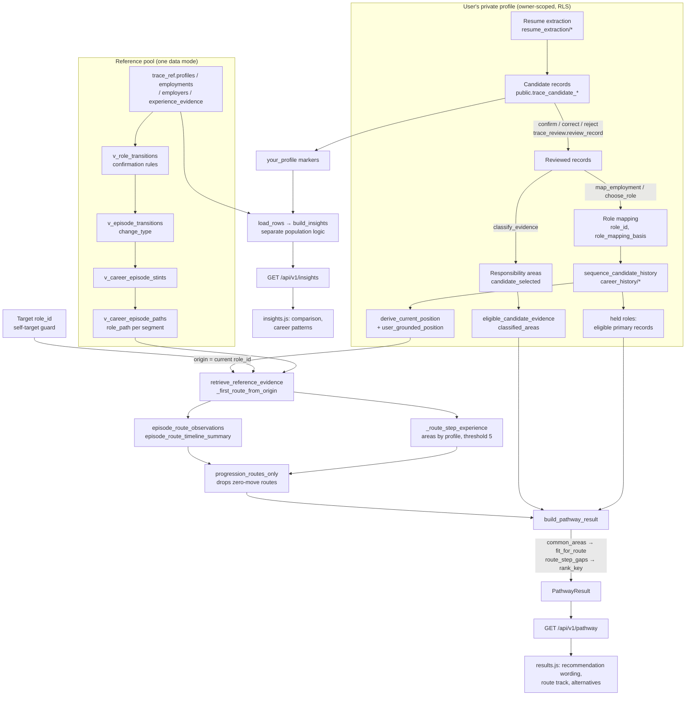

# Recommendation Intelligence Audit (Phase 8)

Audit date: 2026-11-15. Scope: the career-path recommendation system as implemented after Phase 7.2.1. Audit only:
no product logic, API, schema, data or frontend was changed.

Each statement is labelled where it matters:

- **[Verified]**: read in the code and/or reproduced against the local synthetic data (commands in Appendix A).
- **[Inferred]**: follows from the code but was not exercised with data (usually because no data exercises it).
- **[Proposed]**: a recommendation, not current behaviour.
- **[Unknown]**: cannot be established from the current code or data.

All data figures come from the 41 synthetic reference profiles (`dataset_class = synthetic_test_fixture`,
`synthetic_demo_allowed`). The real reference pool is empty, and the 18 consented resumes discussed earlier are not
in this environment. Nothing here describes real-world careers or real-data recommendation quality.

---

## 1. Executive summary

**Short answer to the central question:** today Trace mostly ranks career transitions that were observed in the
reference profiles from the user's exact current role to the chosen target. Personalisation is narrow, and on the
current synthetic data it has no effect on any outcome.

1. **[Verified] Route discovery uses two inputs only: the user's current standard role and the target role.**
   A route is the observed sequence, inside one reference person's history, from that person's first episode in the
   user's current role to their first later episode in the target role. Earlier roles, industries, skills,
   qualifications, seniority and responsibilities play no part in which routes exist.
2. **[Verified] Ranking has three keys, in order:**
   - fit tier;
   - the number of intermediate roles on the route that the user has not held;
   - then alphabetical route id.

   Frequency, the number of supporting profiles and evidence class are never ranking inputs.
3. **[Verified] Fit measures one thing.** A route is "common" in an area when that area is recorded by more than half
   of its reference profiles, and only when at least 5 of those profiles recorded it. Fit asks whether the user's own
   reviewed, classified responsibility areas cover those common areas. Skills, qualifications and industry are not
   used.
4. **[Verified] On the current synthetic data, no route can reach any tier except "fit not established".**
   - Of the routes that survive the Phase 7.2.1 zero-move exclusion, only `PM-APM>PM-PM` (13 profiles) discloses
     areas, and none of its areas is recorded by a majority.
   - `PM-PM>PM-SPM` (5 profiles) has its areas withheld.
   - Every other route has fewer than 5 profiles and is suppressed.

   So "Your recommended pathway" is currently unreachable in internal testing. It is covered only by unit tests that
   use constructed evidence.
5. **[Verified] Profiles A and B get identical results.** SYN-001 (Software Engineer → APM → PM) and SYN-002
   (QA Analyst → Business Analyst → PM) both get exactly one route to Senior Product Manager (`PM-PM>PM-SPM`), the
   same tier (`not_established`, reason `reference_areas_withheld`) and the same rank. Their different histories,
   responsibility areas (product discovery, roadmap and engineering vs prioritisation, QA and requirements),
   industries and skills change nothing.
6. **[Verified] Personalisation that does exist is confined to:**
   - step gaps (intermediate roles not held), which can reorder routes;
   - fit tiers, which cannot vary on today's data;
   - the explanation layer: "experience you already have", "In your profile" markers, guidance text.
7. **[Verified] Evidence volume is very thin:**
   - 35 origin → target pairs have at least one route;
   - 35 of the 37 routes behind them rest on 1 or 2 profiles (28 on one);
   - 2 pairs (QA Analyst → PM, Product Analyst → PM) offer an alternative at all.

   When alternatives tie, the order is alphabetical, so the first-listed path can be decided by the spelling of role
   ids.
8. **Defects and risks found. None was fixed during this audit.**
   - **(a) Single-person routes are revealed.** Routes under 5 profiles are still shown with their full role
     sequence. That would reveal distinctive single-person careers in real data.
   - **(b) A contributor's own profile counts.** Their de-identified reference profile can count towards their own
     routes and comparisons.
   - **(c) Generic guidance for one reason.** `POSITION_GUIDANCE` has no entry for the Phase 7.2.1 reason
     `role_unconfirmed`, so users see generic text.
   - **(d) Downward moves can appear as paths.** A demotion, for example PM → APM, would be shown as a path, because
     no seniority direction check exists.

   Details are in §15.

**Biggest gap.** The product promises "career paths relevant to your experience". The engine delivers "transitions
others made from your exact current role", with a relevance signal (fit) that the data almost never allows it to
compute.

**Top three improvements:**

- P1: make relevance computable and honest with existing data.
- P2: add a profile-to-route relevance model built on the whole confirmed history.
- P3: build an offline evaluation harness with reviewer-labelled scenarios before changing the ranking.

Sections 15 and 18 give the details.

---

## 2. Architecture and data flow

Two separate statistical paths reach the user:

- **the pathway**: route discovery, fit and ranking, all per route;
- **career insights**: distributions over the people who held the target role, or the whole sample when fewer than
  15 did.

The "How your experience compares" section on the pathway page is built from the insights response, not from the
pathway engine. **[Verified]** `web/js/views/results.js` → `drawLandscape` → `profileInContext`.

---

## 3. Implementation map

| Stage | File / object | Function(s) | Notes |
|---|---|---|---|
| Extraction | `app/services/resume_extraction/*`, `app/demo/fixtures.py`, `app/services/real_resume.py` | `FixtureExtractor`, `real_parser`, `process_real_resume` | Produces pending drafts |
| Review and correction | `app/services/candidate_profile/service.py` | `confirm_record` (l. ~529), `_review`, `correct_record` | DB `trace_review.review_record`; corrections append-only |
| Role mapping | `service.py`; `app/services/role_mapping/*` | `map_employment` (~710), `choose_role` (~738), `match_title`, `role_mapping_options` | `role_mapping_basis` = `alias_match` or `candidate_selected` |
| Candidate sequencing | `app/services/career_history/*` | `sequence_candidate_history` | Eligibility mirrors the reference rules |
| Current position | `service.py` | `derive_current_position` (351), `user_grounded_position` (376) | Phase 7.2.1: user-confirmed role required |
| Classification | `service.py` | `classify_evidence` | Basis `candidate_selected` |
| Candidate evidence for fit | `app/services/candidate_profile/pathway.py` | `eligible_candidate_evidence` (141), `_exclusion` (173) | Reviewed + classified + not stale + on an eligible job |
| Reference sequence | migration `20261111120700_trace_analytics_views.sql` | `v_employment_classified`, `v_career_sequence`, `v_role_transitions` | Eligibility and confirmation rules (§4.3) |
| Episodes | migration `20261111130000_trace_episode_pathways.sql` | `v_episode_transitions`, `v_career_episode_stints`, `v_career_episode_paths`, `episode_route_observations()`, `episode_route_timeline_summary()` | Role and employer episodes |
| Route retrieval | `app/services/reference_evidence/service.py` | `retrieve_reference_evidence` (129), `_first_route_from_origin` (277), `_first_route_per_profile` (261), `_route_step_experience` (212) | One data mode per call |
| Zero-move exclusion | same | `is_zero_move` (104), `progression_routes_only` (110) | Phase 7.2.1 |
| Repository SQL | `reference_evidence/repository.py` | `MODE_EPISODE_PATHS_SQL`, `STEP_EXPERIENCE_SQL`, `min_display_count` | `min_display_count` = `min_profiles_limited` (5) |
| Pathway assembly | `pathway.py` | `common_areas` (189), `fit_for_route` (216), `route_step_gaps` (230), `rank_key` (240), `build_pathway_result` (298), guidance templates | Pure functions |
| Orchestration | `service.py` | `pathway_result` (642): self-target guard, evidence, assembly | |
| API | `app/api/pathway_routes.py` | `pathway` (113), `PathwayResponse`, `sample_caution_below` | Cohort from `requested_cohort` |
| Insights | `app/services/career_insights/{repository,service}.py`; `app/api/insights_routes.py` | `load_rows` (80), `build_insights` (278), `distribution` (142), `your_profile` (80), `_prior_roles` (200) | Separate population rules |
| Frontend | `web/js/views/results.js`, `insights.js`, `charts.js` | `isStrong` (15), `drawRoutes` (132), `uniqueMostObserved` (167), `alternatives` (246), `profileInContext` | Labels follow `fit.tier` only |

---

## 4. Route-generation methodology [Verified]

### 4.1 Unit of a route

The unit is the **episode**: one role at one employer.

- Consecutive reference employments with the same role at the same (or an unknown) employer collapse into one stint.
- The same role at a different employer is a new stint (`employer_change`).

Source: `v_career_episode_stints`, through `starts_stint`.

### 4.2 Segments

A segment is a maximal run of records joined by **confirmed** transitions. An ineligible record, or an unconfirmed
transition, starts a new segment. Routes never cross segments.

### 4.3 What breaks a chain

**Record ineligibility** (`v_employment_classified.exclusion_reasons`):

- parallel activity;
- not full-time (unless flagged as counting);
- unresolved role;
- mapping not confirmed;
- mapping confidence below `min_mapping_confidence` (0.8);
- unknown start date.

**Unconfirmed transitions** (`v_role_transitions`):

- previous role still ongoing;
- timing unknown (end or start missing);
- order conflict;
- overlap;
- an uncertain boundary (for example, year-only dates in the same year).

Only `sequential` and `same_month_boundary` are confirmed.

In the synthetic data, 55 of 63 transitions are confirmed. The 8 unconfirmed ones are caused by:

- mapping not confirmed;
- low confidence;
- timing unknown;
- an unknown start;
- an overlap;
- an uncertain boundary;
- an unresolved role;
- a part-time record.

4 profiles (SYN-034 to SYN-037) have two segments; SYN-038's only path is segment 3.

### 4.4 Origin and destination

The service is called with `origin_role_id` set to the user's current role id (`pathway_result`, `route_evidence`).

`_first_route_from_origin` works per reference profile, lowest segment first:

1. Take the first stint in the origin role.
2. Take the first later stint in the target role.
3. The route is the role ids from (1) to (2), inclusive.

A person contributes **at most one observation per (origin, target) query**: their first occurrence. People who
reached the target without ever holding the origin role are not included at all. Without an origin (the internal
API only), the route runs from the segment start to the first arrival.

### 4.5 Intermediate roles, length and identity

- Intermediate roles are whatever stints lie between origin and destination in that person's history. They are not
  discovered by search, and transitions are not chained across people.
- **Routes are complete observed sequences from individual histories, not compositions of role-to-role
  transitions.**
- A route's identity is the tuple of role ids, and `route_id` joins them with `>`. Routes are deduplicated by exact
  tuple.
- Routes of different lengths are different routes; nothing merges `PM>SPM` with `PM>LEAD>SPM`.
- Repeated role ids inside a route are kept (an employer change in the same role).

### 4.6 Zero-move exclusion (Phase 7.2.1)

`progression_routes_only` drops any route whose first and last role ids are equal. The underlying records and
views are untouched. In the synthetic data this removes:

- `PM-PM>PM-PM` (7 profiles);
- `PM-DIR>PM-DIR` (1 profile).

It is applied in `pathway_result` and `route_evidence`; `build_pathway_result` also re-applies it.

### 4.7 Aliases and canonical ids

- Titles are resolved to `role_id` at mapping time, by the alias matcher or the user's choice.
- Reference employments carry a curated `role_id`.
- Every comparison in route generation and fit uses role ids; titles are display-only.

### 4.8 Chronology and missing dates

- Order comes from `sequence_index`, validated against dates by the confirmation rules.
- A record with no start date is ineligible and splits the segment.
- Route months are reported, but timelines are never shown for synthetic data
  (`min_dated_profiles_for_timeline` = 20).

### 4.9 The four example routes

How the requested routes would be represented, given how origin and first arrival work.
**[Verified]** for the mechanics; **[Inferred]** where no profile in the data has that exact history.

| Example history | User current role | Target | What the engine produces |
|---|---|---|---|
| A. SWE → APM → PM → SPM | PM | SPM | Truncated suffix `PM-PM>PM-SPM`. The person's SWE and APM steps are not part of the route; they count only as one more profile on `PM>SPM`. SYN-031 and SYN-033 (APM → PM → SPM) are counted exactly like this. |
| A. same history | APM | SPM | `PM-APM>PM-PM>PM-SPM` (2 profiles in the data: SYN-031, SYN-033) |
| A. same history | SWE | SPM | `ROLE-SWE>PM-APM>PM-PM>PM-SPM` if such a person exists (none in the data) |
| B. QA → BA → PM → SPM | PM | SPM | Same `PM-PM>PM-SPM` route as A; the QA and BA background is invisible to route identity |
| B. same history | QA | PM | `ROLE-QA>ROLE-BA>PM-PM` (SYN-002) alongside `ROLE-QA>PM-APM>PM-PM` (SYN-003) |
| C. PM → SPM | PM | SPM | `PM-PM>PM-SPM` (5 profiles: SYN-020, 021, 028, 031, 033) |
| D. APM → PM → APM → PM | APM | PM | `PM-APM>PM-PM`: first arrival, so the return to APM is never seen |
| D. same history | PM | APM | `PM-PM>PM-APM`. A downward move would be offered as a path to APM, because APM is a selectable target and there is no seniority-direction check. No such profile exists in the data. |
| D. same history | APM | APM | Zero-move: excluded |

---

## 5. Ranking methodology [Verified]

`rank_key(tier, step_gaps, route_id) = (TIER_ORDER[tier], len(step_gaps), route_id)` (`pathway.py`, l. 240). Routes
are sorted ascending and numbered from 1.

| Factor | Source | Transformation | Weight / kind | Missing values | Ties |
|---|---|---|---|---|---|
| Fit tier | `fit_for_route` | `aligned`=0, `partial`=1, `limited`=2, `not_established`=3 | First sort key (lexicographic, no weights) | No common areas, or the user has no classified areas → `not_established` (worst) | Next key |
| Step gaps | `route_step_gaps(route, held_roles)` | Count of distinct intermediate role ids (excluding first and last) not in the user's eligible primary history | Second key | Ineligible or unmapped jobs don't count as held | Next key |
| Route id | `">".join(route)` | String | Third key | n/a | Final, deterministic, **alphabetical** |
| Frequency / supporting profiles | `RouteCohortSummary.supporting_profile_count`, `observation_count` | **Not used** in ranking. Shown in the UI; the "Most common" badge (`uniqueMostObserved`, frontend) is display only | n/a | Suppressed below 5 | n/a |
| Evidence class | `episode_route_timeline_summary.evidence_class` | Passed through; always `synthetic_test_only` in synthetic mode. Empirical: `strong` ≥ 40, `moderate` ≥ 15, `limited` ≥ 5 profiles | **Not used**, not shown | | |

Not implemented anywhere in ranking:

- current-role similarity (the origin must match exactly);
- intermediate-role similarity;
- skill, qualification, industry or organisation-type overlap;
- seniority compatibility;
- route length as such (only intermediate roles *not held* count).

**Where stored:** nowhere. `PathwayRoute.rank` is computed per request and returned in `GET /api/v1/pathway`;
nothing is cached (asserted by `tests/test_phase721.py::TestZeroMove::test_no_route_result_is_cached`).

### 5.1 Worked ranking examples

Reproduced with the real `retrieve_reference_evidence`, `progression_routes_only` and `build_pathway_result` over
the synthetic pool (Appendix A).

**Example 1: SYN-001 vs SYN-002, target Senior PM.**

| | SYN-001 | SYN-002 |
|---|---|---|
| Confirmed history | SWE → APM → PM | QA → BA → PM |
| Classified areas | product_discovery, roadmap_ownership, technical_engineering | prioritisation_backlog, quality_testing, requirements_analysis |
| Industries | SaaS | enterprise software, IT services |
| Routes to SPM | `PM-PM>PM-SPM` | `PM-PM>PM-SPM` |
| Route evidence | 5 observations, `areas_withheld` (each area recorded by fewer than 5 of the 5) | same |
| `common_areas` | `[]` (state isn't `areas_disclosed`) | `[]` |
| Fit | `not_established` / `reference_areas_withheld` | same |
| Step gaps | `[]` (direct move) | `[]` |
| Rank key | (3, 0, "PM-PM>PM-SPM") → rank 1 | identical |

Outcome: identical. Only the "experience you already have" lists and guidance text differ.

**Example 2: current QA Analyst, target Product Manager.** This is a constructed current role: the reference routes
are real fixture routes, but no fixture's *current* role is QA. Two routes exist, each with 1 profile, both
suppressed and `not_established`.

| User has also held | `ROLE-QA>PM-APM>PM-PM` key | `ROLE-QA>ROLE-BA>PM-PM` key | Order |
|---|---|---|---|
| nothing else | (3, 1, "ROLE-QA>PM-APM…") | (3, 1, "ROLE-QA>ROLE-BA…") | APM route first, **only because "P" sorts before "R"** |
| Business Analyst | (3, 1, …) | (3, 0, …) | BA route first (no step gap) |
| APM | (3, 0, …) | (3, 1, …) | APM route first |

This is the only way earlier roles affect ranking today.

**Example 3: current APM, target PM, with varying classified areas.**

- Route `PM-APM>PM-PM`: 13 observations, `areas_disclosed`.
- Disclosed areas:
  - outcome_ownership: 5 profiles, not common (5 is not more than 13 / 2);
  - prioritisation_backlog: 5 profiles, not common.
- `common_areas` = `[]` → `no_common_area_on_route` → `not_established`, whatever the user classified (tested with
  none, one, and both areas).

**Example 4: current PM, target Lead PM.**

- One route, `PM-PM>ROLE-ENT>PM-LEAD` (Founder / Co-founder in the middle), from a **single** profile (SYN-040).
- Suppressed counts and areas.
- Step gap ROLE-ENT generates the guidance "Observed routes here pass through Founder / Co-founder… consider whether
  a Founder / Co-founder role is a step you want to explore."

That is generated advice derived from one person's career (see §15, R1).

---

## 6. Fit-state determination [Verified]

| State (API `fit.tier`) | Criteria | Thresholds and source | UI wording (Phase 7.1+) |
|---|---|---|---|
| `aligned` | Common areas non-empty and every common area is in the user's classified areas | Common = route disclosed (observations ≥ `min_profiles_limited`, 5), area profile count ≥ 5, and area count > half of observations. Source: `trace_ref.analytics_settings`, read via `min_display_count()` | "Your recommended pathway" / "Recommended path" |
| `partial` | Some common areas matched | same | "A possible path…" + "Partial match" |
| `limited` | Common areas exist, none matched | same | "Few matches yet" |
| `not_established` | Route suppressed (< 5 observations), areas withheld, no recorded areas, no majority area, or the user has no classified areas | same | "Fit could not be established" |
| No route | No reference profile went from the current role to the target within one segment | n/a | "No reliable pathway is available yet." |
| Unknown position | Current role not established (Phase 7.2/7.2.1) | n/a | "Confirm your current role…" |

**Configuration:**

- `min_profiles_limited` (5) is configurable in `analytics_settings`.
- The majority rule (> 50%) is hard-coded (`2 * profile_count > observation_count`).
- `min_profiles_moderate` (15, also `sample_caution_below`) does **not** affect fit or ranking. It drives only the
  insights scope and the UI's small-sample caution.

**What fit is and isn't.** Fit is entirely a function of:

- responsibility-area **data presence** on the route;
- the user's own **classification** of their evidence.

It doesn't measure similarity between the user and the people on the route, route frequency, or outcomes.
`not_established` mixes two different meanings: "the route has too little evidence" and "you haven't categorised
your experience". The `reason` field separates them; the tier does not.

**What Trace can legitimately claim today:**

- "N reference profiles that held your current role later held the target role, via these roles."
- "Most of them recorded these areas, and your categorised evidence covers them or not."

It cannot claim that a route is relevant to the user, likely to work, typical in the wider market, or better than
another route.

---

## 7. Personalisation analysis [Verified]

| Profile attribute | Affects which routes exist? | Affects ranking? | Affects fit? | Affects explanations? |
|---|---|---|---|---|
| Current standard role | **Yes** (origin) | via routes | via routes | yes |
| Target role | **Yes** | via routes | via routes | yes |
| Previous roles | no | only as step gaps (intermediate roles held) | no | step-gap notes, "In your profile" markers |
| Responsibility areas (classified, reviewed) | no | via fit tier | **yes**, but only against majority-common route areas | yes |
| Unclassified evidence text | no | no | no | guidance only |
| Skills | no | no | no ("Skills: not assessed") | insights markers |
| Qualifications, field, institution | no | no | no | insights markers |
| Industry, organisation type or size | no | no | no | insights markers |
| Seniority / years of experience | no | no | no | no |
| Employment dates | eligibility only | no | no | no |

**Answer:** two users with the same current and target role always get the same set of routes, with the same
observed evidence.

- Their order can differ only by fit tier (needs disclosed majority areas, which the current data never has) and by
  step gaps.
- The engine never compares the user with individual reference profiles. It compares the user's areas with route
  aggregates.
- Previous roles are used for step gaps; skills and qualifications are explanation-only.

With today's synthetic data, the user's profile affects **nothing** but explanations and step-gap ordering. Example 1
shows this end to end.

---

## 8. Evidence-quality analysis [Verified]

| Concept | How it is represented today |
|---|---|
| Privacy sufficiency | `min_profiles_limited` = 5. Counts and areas below it are suppressed. **The route itself is still shown** (§15, R1). Insights suppress cells under 5. |
| Evidence availability | `experience_state` (suppressed / withheld / no areas / disclosed); `observation_count` (≥ 5 or null) |
| Recommendation relevance | Only fit tier (areas). No similarity measure. |
| Recommendation reliability | **Not modelled.** `evidence_class` exists (frequency bands) but is unused. No measure of diversity, completeness, or the spread of supporting profiles. |
| Profiles supporting a route | `supporting_profile_count` / `observation_count` |
| Diversity of supporting profiles | Not measured (could all come from one industry or one employer pattern) |
| Completeness of histories | Implicit: incomplete records break segments and are silently absent |
| Chronological consistency | Enforced by confirmation rules; not reported per route |
| Responsibility coverage | Only via disclosed areas; 105 of 106 evidence rows carry an area, about 2.6 rows per profile |
| Skill coverage | Not used in routes (174 skill rows across 41 profiles) |
| Target-role coverage | Not reported per target; see §13 |
| User-to-supporting-profile similarity | Not measured |
| Intermediate-step evidence | Only the step's presence in the observed sequence; areas pooled across all pre-destination steps |

**5 vs 15 profiles.** A route observed in 15 profiles is **not** ranked above one observed in 5, or in 1. Order
changes only through fit tier and step gaps. This is deliberate ("route frequency never ranks anything",
`pathway.py` docstring). The only frequency signal is the display-only "Most common" badge. Frequency also says
nothing about success: no outcome is measured anywhere.

---

## 9. Alternative-route analysis [Verified]

- **How generated:** they are simply every other distinct route between the same origin and target, ranked by the
  same `rank_key`, each with its own fit and step gaps.
- **Distinctness:** routes are distinct role-id sequences, but they are not tested for meaningful difference. A route
  with an extra same-role employer change (for example `APM>APM>PM` vs `APM>PM`) would be a separate
  "alternative" with near-identical meaning **[Inferred]**; none exists in the data.
- **Profile comparison:** each alternative gets its own fit and step gaps from the same profile.
- **When the top route is a poor match:** an alternative ranks first only through tier or step gaps. There is no
  other mechanism (for example, "people with your background more often went via X").
- **Data reality:** 2 of the 35 origin → target pairs with any route have alternatives (QA → PM, Product Analyst →
  PM), each a pair of single-profile routes. Every alternative in the synthetic data is suppressed and
  `not_established`. Showing "Other possible paths" built from 1-profile routes gives an illusion of choice: the
  differences between them aren't evidenced, and their order is alphabetical.

---

## 10. Worked examples

See §5.1 for Examples 1–4, all computed with the production functions. In summary:

| # | Input | Routes (rank: id, n, tier) | What decided the order |
|---|---|---|---|
| 1 | SYN-001 (SWE→APM→PM) → SPM | 1: `PM-PM>PM-SPM`, 5, not_established (areas withheld) | Single route |
| 1b | SYN-002 (QA→BA→PM) → SPM | identical | Single route; profile ignored |
| 1c | SYN-001 or SYN-002 → Lead PM | 1: `PM-PM>ROLE-ENT>PM-LEAD`, 1, not_established (suppressed); step gap Founder | Single 1-profile route |
| 1d | SYN-001 or SYN-002 → Director | no route | n/a |
| 2 | current QA → PM | `ROLE-QA>PM-APM>PM-PM` (1) and `ROLE-QA>ROLE-BA>PM-PM` (1), both not_established | Step gaps, then alphabetical |
| 3 | current APM → PM | `PM-APM>PM-PM`, 13, not_established (no majority area) | Fit can't be established whatever the user classified |

---

## 11. Current evaluation coverage

| Evaluation dimension | Current coverage | Evidence | Gap |
|---|---|---|---|
| Correct origin role | Strong for mechanics | `test_reference_evidence.py` `TestOrigin` (origin first occurrence, segments); fixture oracle `test_fixture_ingestion_integration.py` | No test that the *right* origin is used for unusual histories (parallel roles, career breaks) beyond eligibility rules |
| Correct target role | Strong | `test_api_phase4.py` invalid targets; `test_phase72_starting_point.py` self-target | none significant |
| Route continuity | Strong (data rules) | `TestEpisodeScenarios`, `test_episode_pathways_db_parity.py`, sequencing tests (71) | Continuity rules are tested; whether broken segments should drop people is a product question |
| Role-sequence validity | Partial | Zero-move tests (`test_phase721.py`) | No test or rule for downward moves (PM → APM) or implausible sequences |
| Profile similarity | **None** | — | Not implemented, so not tested |
| Ranking relevance | **None** | `test_pathway_result_unit.py` checks the rank *rule* (tier, gaps, id; "never frequency") | Nothing checks that the top route is relevant to the person |
| Fit-state correctness | Strong for the rule | Unit `test_fit_tiers`, `test_common_needs_disclosure_threshold…`; fixture oracle recomputes tiers with the same formula | The oracle duplicates the formula, so it proves consistency, not correctness of the concept. No end-to-end test reaches `aligned` on current data. |
| Evidence completeness | Partial | Disclosure-state tests (4 states) | No per-route completeness or diversity measure |
| Alternative-route quality | **None** | Ordering unit tests only | No distinctness or usefulness test |
| Robustness to missing profile data | Partial | Current-position reasons, unclassified-evidence guidance, `not_established` reasons | No test of how outputs degrade as profile completeness varies |
| Stability after profile corrections | Partial | Stale mapping, re-match and target-becomes-current tests | No test that irrelevant edits leave the ranking unchanged |
| Synthetic/real source isolation | Strong | `test_sharing_phase71.py` production tests, `test_real_reference_integration.py`, mutation checks | none significant |

The mutation checks (Phases 7.1–7.2.1) guard safety rules: no self-target, no zero-move, wording, isolation. None
guards relevance.

---

## 12. Proposed offline evaluation framework [Proposed]

**Principle:** separate automated **regression** checks (deterministic, run in CI) from **expert relevance** judgments
(human, periodic). Don't change ranking until both exist.

### 12.1 Scenario set

Build a versioned set of evaluation profiles. These are inputs, not reference data, and are kept out of every
reference pool. Use the existing fixture schema. Each scenario is a confirmed private profile plus a target. Cover:

- **Backgrounds:** engineering, QA, analytics, design, business-side, and PM-native (fixture histories already
  provide most).
- **Targets:** every PM target, including ones with no evidence.
- **Completeness levels:** full classification; partial; none; missing dates.
- **Ambiguous current role:** low confidence, Product Owner clarification, unresolved.
- **Route shapes:** direct; multi-step; multiple plausible routes; no route.
- **Support levels:** reference pools constructed with 1, 5, 15 and 40 supporting profiles. This needs synthetic
  pools built for the evaluation; the shared synthetic fixtures must not be modified.

### 12.2 Measures

| Measure | What it measures | How evaluated | Ground truth needed | Limitations |
|---|---|---|---|---|
| Transition validity | Every adjacent pair in a returned route is a plausible career move (no zero-move, no unflagged downward move) | Automated rule check over all outputs | A reviewed list of allowed or flagged transitions (taxonomy owner) | Plausible isn't the same as relevant |
| Evidence traceability | Every displayed claim (count, area, gap) maps to API fields and source rows | Automated: rebuild from the DB in tests | None | Doesn't judge usefulness |
| Fit-label consistency | The same inputs give the same tier; the tier matches the stated reason | Automated property tests | None | Consistency, not correctness |
| Sensitivity | Relevant profile changes (adding classified areas or a held intermediate role) move the outputs in the expected direction | Automated metamorphic tests | Expected direction per change type, agreed with product | Needs a model where those inputs matter |
| Stability | Irrelevant changes (typo fixes, an unrelated skill) don't change ranking | Automated metamorphic tests | List of "irrelevant" changes | Defining "irrelevant" is a product decision |
| Top-route relevance | Whether the first route makes sense for this person | Expert panel rates each scenario's top route on an agreed scale, blind to the system's label | Reviewer labels (2+ reviewers, agreement measured) | Subjective, slow, small samples; synthetic profiles limit realism |
| Alternative usefulness | Whether alternatives are genuinely different and worth showing | Expert rating plus an automated distinctness rule (e.g. differ by a non-repeated role) | Reviewer labels | Same as above |
| Profile-to-route alignment | Whether the explanation ("experience you already have") is correct and complete | Expert review against the profile | Reviewer labels | Depends on classification quality |

No acceptance thresholds are proposed yet. They should come from a first labelled baseline run, not be invented
beforehand.

---

## 13. Reference-data coverage and limitations [Verified]

- **Profiles and histories:**
  - 41 profiles, 45 segments, 106 employments across 26 role ids.
  - Segment path lengths: 1 stint (6), 2 (25), 3 (12), 4 (2).
- **Confirmed role changes are concentrated:**
  - APM → PM: 13;
  - PM → SPM: 5;
  - 24 other pairs with 1–2 each.
- **Final roles of segments:** PM 31, SPM 5, Director 3; other roles are single digits.
- **Coverage of targets from a PM current role:**
  - SPM: 5 profiles;
  - Lead: 1;
  - Principal: 1;
  - **no route** to Group PM, Head, Director or Senior Director.
  - From SPM: Director only (2).
- **Origins:** 22 distinct first roles. Most non-PM origins appear in exactly one profile.
- **Industries:**
  - SaaS 15, consumer internet 11, enterprise software 8, fintech 8, then a long tail;
  - 2 profiles "unknown".
- **Profile detail:**
  - responsibility evidence: 106 rows, about 2.6 per profile, almost always one line per job;
  - skills: 174 rows;
  - education: 44 rows.
- **Areas by distinct profiles:** roadmap ownership 27, outcome ownership 15, prioritisation 9, data analysis 8.
  Nine other areas have 6 or fewer profiles.
- **Duplicated histories:** 7 identical PM → PM (employer change) profiles, 5 PM → SPM, and many single-step
  "X → PM" profiles.

**What the 41 profiles can test:**

- every branch of route generation, confirmation, suppression and isolation;
- the self-target and zero-move rules;
- UI states for "possible path" and "no route";
- most fit *reasons*.

**What they cannot test:**

- the `aligned`, `partial` or `limited` tiers end to end (no majority areas);
- meaningful alternatives;
- frequency effects;
- any claim about real-world relevance or quality.

They are internal test fixtures written to exercise behaviour, not a sample of careers.

**The real pool is empty.** No real-data validation has taken place.

---

## 14. Current vs intended Trace experience

| Intended user question | What Trace delivers today | Gap |
|---|---|---|
| 1. Which paths are relevant to my experience? | Paths observed from my exact current role | Relevance isn't modelled; background is ignored |
| 2. Why is one path a stronger match? | Tier (rarely computable), then roles not held, then alphabetical | No real comparative explanation; ties broken arbitrarily |
| 3. Which of my experience supports it? | Matched common areas (when computable); "experience you already have" from insights | Works only through categorised responsibilities; skills and qualifications not used |
| 4. What isn't evident yet? | Area gaps and step gaps; insights "not yet shown" | Reasonable; depends on the same thin areas |
| 5. What patterns support it? | Counts (≥ 5), disclosed areas, insights distributions | Pathway evidence and insights populations differ; can confuse |
| 6. How much evidence? | Counts, suppression, small-sample caution | No reliability or diversity measure; single-profile routes shown |
| 7. Where can't Trace assess? | `not_established` reasons, "not assessed" list | Good honesty; but "not established" is the default outcome |

---

## 15. Defects, risks and improvement opportunities

### 15.1 Defects and risks found (not fixed in this audit)

| ID | Finding | Evidence | Recommended fix |
|---|---|---|---|
| R1 | **Suppressed routes still reveal their full role sequence.** A route from 1 profile (e.g. `PM-PM>ROLE-ENT>PM-LEAD`, SYN-040) is shown, with generated guidance from its step. With real data this discloses that some contributor followed a distinctive path, and it builds advice on one person. | `build_pathway_result` keeps every summary; the counts and areas are suppressed, the route is not. Example 4. | Decide a privacy rule for showing route existence (e.g. hide or aggregate routes below `min_profiles_limited`, show "too few profiles to describe"). Needs a privacy/product decision before real data. |
| R2 | **A contributor's own reference profile can support their own recommendations and comparisons.** By design there's no link from a reference profile to its contributor. | `trace_ref.profiles.contributor_user_id` is null for contributions; no self-exclusion in `reference_evidence` or `career_insights`. | Design a privacy-preserving self-exclusion (e.g. a keyed per-user token stored with the contribution and passed only server-side), or document it as acceptable. Needs a design decision. |
| R3 | `POSITION_GUIDANCE` has no `role_unconfirmed` entry, so the pathway's next step falls back to "Establish your current position first." | `pathway.py` `POSITION_GUIDANCE`; reason added in Phase 7.2.1 | Add the entry (one line, with a test). |
| R4 | Downward moves would be presented as paths: a PM targeting APM would see `PM>APM` if any profile did that; there's no seniority-direction check | `TARGETS` include PM-APM; route retrieval is direction-agnostic | Decide whether downward and lateral targets are allowed; flag or exclude them using `trace_seniority_levels` ranks |
| R5 | `not_established` conflates "too little route evidence" with "you haven't categorised" | `fit_for_route` | Separate them in the API (`fit.evidence_state` vs `fit.profile_state`) or in UI wording |
| R6 | Ties are broken alphabetically and presented as rank 1 | `rank_key` | Present tied routes as equals, or add a documented secondary criterion (P2) |
| R7 | The recommended state is unreachable with the synthetic fixtures after Phase 7.2.1, so there's no end-to-end coverage of "Your recommended pathway" | §5.1 Example 3, §13 | Build evaluation-only reference pools with majority areas (§12.1) without changing the shared fixtures |

### 15.2 Prioritised improvements [Proposed]

**P1. Make relevance computable and honest with existing data.**

- *Problem:* fit is almost never established; tied and suppressed routes are presented as ranked choices.
- *Why it matters:* users see a "possible path" chosen alphabetically.
- *Existing:* `fit_for_route`, `rank_key`, frontend labels.
- *Change:*
  - fix R1 (route-existence threshold);
  - fix R5 (split the reasons);
  - fix R6 (show ties as ties);
  - add `evidence_summary` per route (count band, suppressed or not);
  - exclude or flag downward moves (R4).
- *Data:* none new.
- *API:* additive fields only.
- *Quality impact:* honest presentation; fewer misleading choices.
- *Evaluation:* transition validity, traceability and consistency tests (§12).
- *Complexity:* low to medium.
- *Dependencies:* privacy decision on R1.
- *Risks:* fewer routes shown, so more "no reliable pathway" outcomes.

**P2. Profile-to-route relevance from the whole confirmed history (deterministic).**

- *Problem:* route discovery and ranking ignore background.
- *Why it matters:* this is the core proposition.
- *Existing:* origin-only retrieval; areas compared only with route majorities.
- *Change:*
  - for each route, measure how similar its *supporting profiles* are to the user, using signals already stored on
    both sides: earlier roles (role-family overlap), classified areas (overlap, not just majority), industry,
    qualification level;
  - rank by a transparent, documented combination, with per-factor explanations ("3 of 5 people on this route also
    came from engineering");
  - optionally widen origins to adjacent roles in the same family, clearly labelled.
- *Data:* the existing fields (roles, areas, industries, education) on both sides.
- *API:* additive per-route `relevance` object with the factor breakdown; no schema change if computed per request.
  Per-profile similarity must respect suppression: only aggregates are disclosed, never which profile matched.
- *Quality impact:* the first real personalisation.
- *Evaluation:* sensitivity and stability tests plus an expert relevance panel (§12).
- *Complexity:* medium.
- *Dependencies:* P3 baseline first.
- *Risks:*
  - small groups make similarity aggregates suppressible;
  - overfitting to synthetic fixtures;
  - weights need justification from labelled scenarios.

**P3. Offline evaluation harness and labelled scenarios.**

- *Problem:* no test measures relevance.
- *Existing:* strong rule tests, fixture oracle.
- *Change:* §12. Build the scenario set, evaluation-only pools and the metamorphic suite; run an expert labelling round
  on the current engine to set the baseline.
- *Data:* synthetic scenarios now; reviewer time.
- *API:* none.
- *Quality impact:* makes P1 and P2 measurable.
- *Complexity:* medium.
- *Risks:* reviewer subjectivity, which calls for agreement checks.

**P4. Evidence-quality measures.**

- *Change:* per-route diversity (distinct origins, industries), completeness (share of supporting profiles with
  areas), and use of `evidence_class` for empirical data.
- *API:* additive.
- *Dependencies:* real data to be meaningful. Implement and test with synthetic pools.

**P5. Skills and qualifications in fit.**

- *Change:* map skills to the taxonomy, a prerequisite that's listed as "not assessed" today.
- *Data:* a skill taxonomy and mapping.
- *Complexity:* medium to high.
- *Risk:* skill extraction quality.

**Doable now, without real data:** P1, P3, the P2 mechanics and tests, and the R3 fix.

**Needs real career histories:**

- validating P2 weights and claims of relevance;
- P4 thresholds;
- any statement about which routes are common or effective in the market;
- the distribution of origins and intermediate roles, which the synthetic data barely covers.

What's missing specifically: multiple profiles per origin → target pair, with classified responsibilities and dates,
across several backgrounds. Today most pairs rest on 1 profile.

---

## 16. API and schema implications [Proposed]

| Change | API | Schema / migration |
|---|---|---|
| R3 guidance | none | none |
| R1 route-existence threshold | Suppressed routes removed or aggregated; possible new `suppressed_routes` count | none (setting could reuse `min_profiles_limited` or add an analytics setting row: data, not schema) |
| R5 split reasons | Additive `fit.evidence_state` / `fit.profile_state` | none |
| R6 ties | Additive `rank_tied_with` or equal ranks | none |
| R4 downward moves | Additive `route.direction` flag, or exclusion | none (seniority ranks exist) |
| P2 relevance | Additive `relevance` with factor breakdown | none if computed per request; aggregate-only disclosure |
| R2 self-exclusion | none visible | **Yes**: needs a contribution-side token or link, a migration and a privacy review |
| P4 evidence quality | Additive | none |
| P5 skills | Additive | Skill taxonomy tables (migration) |

---

## 17. Risks and trade-offs

- **Honesty vs emptiness.** Stricter display rules (R1) mean more users see "no reliable pathway" until real data
  grows.
- **Personalisation vs privacy.** Comparing a user with the people on a route works on small groups. Aggregates must
  stay suppressed, and no output may reveal which reference profile matched.
- **Weights without ground truth.** Any P2 weighting chosen before P3 labels is arbitrary. Weights must be documented
  and evaluated.
- **Synthetic overfitting.** The fixtures were written to exercise behaviour; tuning on them would encode the
  fixtures' author's assumptions.
- **Frequency as quality.** Even with real data, a common route is not proof of a good one; no outcomes are measured.
- **Scope creep.** None of this needs an LLM or ML model; a transparent deterministic model fits the current data
  volumes.

---

## 18. Recommended implementation sequence [Proposed]

1. **R3 (one-line fix) and R7.** Build evaluation-only synthetic reference pools in the test suite, so `aligned`,
   `partial` and `limited` are exercised end to end.
2. **P3.** Build the scenario set, metamorphic tests and baseline expert labelling of the current engine.
3. **P1.** Make the following decisions, then implement them as additive changes:
   - route-existence privacy rule (R1);
   - reason split (R5);
   - honest ties (R6);
   - downward-move policy (R4).
4. **P2.** Prototype relevance behind a server-side flag in synthetic mode only. Compare against the P3 baseline
   before adopting.
5. **R2 design** (self-exclusion) before any real-data activation.
6. **P4 and P5** once real contributed profiles exist in volume; then re-run P3 against real data separately (never
   mixed with synthetic data).

---

## Appendix A. How the figures were produced

All read-only, against the local database, synthetic mode only, with the production functions.
Nothing was written.

- **Data profile:** queries over `trace_ref.v_career_episode_paths`, `v_episode_transitions`, `employments`,
  `employers`, `experience_evidence`, `profile_skills` and `education`, filtered to synthetic profiles.
- **Route enumeration:** for every origin role present in the data and every PM target,
  `retrieve_reference_evidence(EvidenceRequest(destination, "synthetic_test", origin))`, then
  `progression_routes_only`, inside `reference_snapshot`.
- **Worked examples:**
  - `build_pathway_result` with the same evidence;
  - the candidate side built from each fixture's curated employments and responsibility areas;
  - held roles taken from the fixture's employments.

  This mirrors a candidate who confirmed and classified everything as curated. Examples 2 and 3 use constructed
  current roles and area sets over the real fixture routes.
- **Settings in force:**

  | Setting | Value |
  |---|---|
  | `min_profiles_limited` | 5 |
  | `min_profiles_moderate` | 15 |
  | `min_profiles_strong` | 40 |
  | `min_dated_profiles_for_timeline` | 20 |
  | `min_mapping_confidence` | 0.8 |

---

## 19. Follow-up: Phase 8.1 (Recommendation Safety and Evaluation Foundation)

Implemented on 2026-11-15. The ranking methodology, fit thresholds and recommendation states are unchanged, and no
whole-profile relevance was added.

### 19.1 Privacy and own-contribution fixes (R1, R2)

**Route-level privacy (R1, fixed).** `reference_evidence.privacy_safe_routes` removes every complete route supported
by fewer distinct reference profiles than the existing small-group minimum (`min_profiles_limited`, 5; a missing
setting shows nothing).

- **What's counted:** distinct profiles per complete route (`route_support`). A profile whose history contains the
  route twice counts once.
- **What's removed:** the route goes from the observations, summaries and step experience together, before pathway
  construction, ranking, fit, guidance and serialisation.
- **Shared composition:** every route consumer uses the same composition, `recommendation_evidence`: the pathway
  (main and alternative routes) and the internal route evidence.
- **Career insights** already suppress every category below 5 (transition pairs, roles before the target, earlier
  roles), and the comparison is built from the insights response.
- **No-route wording:** the pathway's "no route" text no longer distinguishes "not observed" from "observed but
  suppressed", so a small group is never revealed.
- **Source records:** untouched.
- **Synthetic data:** the single-profile Product Manager → Founder → Lead PM route no longer appears on any surface
  (API, insights, route evidence; verified in tests and in Chrome).

**Own-contribution exclusion (R2, fixed).** A new read-only function, `trace_contrib.my_reference_profile_ids()`
(migration v2.13.0), returns the caller's own contributed reference profile ids.

- **Why it needed a migration:** the user-to-contribution link exists only in admin-only `trace_private`.
- **Scope of the function:** owner role, request identity, no other grant.
- **Where it's used:** the service passes the ids as `exclude_profile_ids` to the evidence service, which drops them
  before any route is picked. Counts are recomputed exactly from the per-profile rows; nothing is "subtracted".
  Insights drop them from every row (`without_profiles`) before any statistic, so denominators and suppression are
  computed without them.
- **What the ids never do:** appear in any response, or create a link in `trace_ref`.
- **What users see:**
  - included contribution: excluded from the contributor's own evidence;
  - under manual review: nothing to exclude (suspension deletes the profile);
  - withdrawn: nothing to exclude (the profile is deleted);
  - every other user: still counts it as independent evidence (verified end to end with five real-resume
    contributors).

### 19.2 Fit-reason distinctions (R5, fixed)

`RouteFit.limitations` is an additive field listing the actual cause or causes:

| Code | Meaning | UI wording |
|---|---|---|
| `incomplete_user_profile` | The user's responsibilities aren't categorised | "Categorise your responsibilities so Trace can compare your experience with this path." (+ link) |
| `insufficient_reference_evidence` | The route's profiles don't record enough responsibility detail (withheld, none recorded, no majority area) | "There's not enough career detail across the available profiles to compare this path reliably." |
| `insufficient_route_evidence` | Too few profiles on the route | "Not enough career profiles show this route for Trace to assess it." |

- Both sides can apply at once.
- The existing `reason` and thresholds are unchanged.
- Since route-level privacy, a *shown* route never has `insufficient_route_evidence`; that case appears as the
  privacy-safe "no reliable pathway" state.

`role_unconfirmed` (R3, fixed) now has its own guidance text, both in the API's next steps and in the UI. The pathway
and target pages offer "Review the role match", which opens the profile with the current job focused, using the
existing "Confirm role" control. A `latest_employment_ineligible` position now shows the specific reason (a missing
start date, not full-time, or a side activity) when the API provides it.

### 19.3 Tie handling (R6, fixed)

- **Unchanged:** the ranking (fit tier, then intermediate roles not held, then route id).
- **New, additive fields:** `rank_group` (routes whose meaningful inputs are equal share a group) and `tied`.
- **Order inside a group:** only the stable route-id order, for consistent rendering.
- **UI:**
  - tied top routes get a plural heading and "These paths are equally ranked based on the available evidence.
    They're listed in a fixed order, not by preference.";
  - tied alternatives get an "Equally ranked" badge.
- **Not used:** frequency.

### 19.4 Seniority-direction investigation (R4, investigated; no change made)

**Findings [Verified]:**

- **Default seniority per role.** Each standard role has a default seniority
  (`trace_role_taxonomy.default_seniority_code`) with a rank in `trace_seniority_levels`:

  | Seniority | Rank |
  |---|---|
  | intern | 10 |
  | junior | 20 |
  | associate | 30 |
  | mid | 40 |
  | senior | 50 |
  | lead | 60 |
  | principal | 65 |
  | group | 70 |
  | head | 75 |
  | director | 80 |
  | senior director | 85 |
  | VP | 90 |
  | executive | 100 |
  | founder | unranked |
  | unknown | unranked |

  "Head" is described as organisation-dependent and often comparable to director.
- **Per-employment seniority is almost never set.** A per-employment `seniority_code` exists, but only 1 of 106
  synthetic reference employments sets it. The effective level is almost always the role's default.
- **Every non-PM role defaults to "mid" (40).** A senior QA engineer and a junior QA analyst are therefore the same
  level. So Software Engineer → Associate PM reads as "down" (40 → 30), although it's a change of career track;
  QA → PM reads as "lateral".
- **The engine doesn't use direction.** `v_role_transitions.seniority_rank_change` exists, but nothing uses it.
- **Aliases** resolve titles to a role id. Level qualifiers in titles, such as "PM II", are not episode boundaries
  (an existing limitation). Title wording therefore doesn't change level, except through a different role id.

**Proposed policy, for product review (not implemented):**

| Move | Proposed treatment |
|---|---|
| Upward (same role family, higher rank) | Show as is. |
| Lateral (same family, same rank) | Show; optionally note "a move at the same level". |
| Downward (same family, lower rank, e.g. Senior PM → PM) | Keep. These are observed transitions, and some are deliberate. Label the step "a move to a role at a lower standard level" and let the user see it. Whether to deprioritise is a ranking decision for a later phase. |
| Across families (e.g. Software Engineer → Associate PM) | Don't call it up or down: default ranks aren't comparable across families. Label it "a change of career track". |
| Unknown (founder, unknown, or a missing rank) | No direction label. |
| Mixed routes | Annotate each step; never summarise a mixed route as a single direction. |
| Targets below the current level | Allowed (users may choose them), with a neutral note on the target page. |

Throughout, distinguish an *observed career transition* (any route people took to the target) from a *career
progression* (a route that moves up). Trace shows transitions and shouldn't call them progressions.

**Decisions needed:**

- (a) whether to show direction labels at all;
- (b) whether cross-family moves get no direction;
- (c) whether downward steps ever affect ranking;
- (d) whether employment-level seniority should be captured at review time, so levels are not inferred from defaults.

The evaluation harness already records per-step directions for scenarios S17–S20.

### 19.5 Evaluation baseline (R7, done)

`docs/RECOMMENDATION_EVALUATION_BASELINE.md`:

- **Inputs:** evaluation-only fixtures (95 `EVAL-` profiles, 22 scenarios).
- **Harness:** a deterministic harness running the production composition.
- **Checks:** 12 automated invariants; baseline sensitivity records.
- **Review material:** human-review templates, all pending.
- **Coverage:** all four fit tiers are now exercised end to end in the harness. In the 41-profile synthetic pool,
  `not_established` is still the only reachable tier.

### 19.6 Outstanding product decisions

1. **Seniority direction:** labels and treatment (§19.4).
2. **The route privacy minimum:** whether to keep it equal to `min_profiles_limited` (5) or set a separate setting.
   Today they're the same value by design.
3. **Who reviews:** who carries out the human relevance review (reviewers, protocol, agreement threshold) before any
   ranking change.
4. **Whole-history relevance (P2):** whether to start, after the review baseline exists.
5. **`/api/v1/cohorts` count:** it still reports the whole real pool, including the caller's own contribution. It is
   an availability indicator; the product frontend doesn't use it. Decide whether it should also exclude the caller.

---

## 20. Follow-up: Phase 8.2 (whole-career personalisation, shadow prototype)

**Decisions applied:**

1. **Own contribution in cohort counts.** User-facing cohort counts (`GET /api/v1/cohorts`) exclude the caller's own
   contribution before counting, and suppress afterwards. Insights and route evidence already did. Responses are
   `no-store`. Administrative scripts still see the global pool.
2. **Route privacy minimum stays 5.** It is not confused with the sample-size caution (15). The distinctive-route
   review found that route-level suppression already guarantees at least 5 profiles share the exact sequence. The only
   new exposure, the prototype's attribute values, gets the narrowest rule: at least 5 supporters per disclosed
   value. The marginal-versus-conjunction residual risk is recorded for a privacy review before any user-facing use
   (prototype doc §7).
3. **Seniority direction is implemented as presentation only** (`routes[].step_directions` and the route track):
   - more senior, more junior or lateral, only within a level-structured family with ranked levels;
   - "change of career track" across families;
   - no label otherwise, including the fallback `mid`;
   - downward moves are kept.
4. **Human review.** A two-reviewer process, a combination rule and adjudication by a third reviewer
   (`RECOMMENDATION_HUMAN_REVIEW.md`). The review pack hides engine judgments. Labels are pending.

**Implementation findings:**

- **Thin responsibility data is the main limiter.** The existing engine personalises on responsibility areas as soon
  as reference profiles record majority areas. It does so in the personalisation pool, but never in the 41-profile
  synthetic pool.
- **The prototype separates profiles on the remaining dimensions.** In shadow mode it distinguishes different
  backgrounds on earlier roles, industries, skills and education. It shows this per dimension, with counts, without a
  score, and without changing production.
- **Production use is blocked by data:**
  - candidate skills are unmapped text, while reference skills are taxonomy ids;
  - industry is rarely known for real resumes;
  - a production read path for supporters' attributes would need its own privacy review.

**Not changed:** route discovery, ranking, fit thresholds, recommendation states, the sharing model, real-resume
uploads, and the reference data.

## 21. Follow-up: Phase 8.2.1 (human-review readiness corrections)

This phase made no production change. The ranking, the API, the database and the frontend are untouched.

1. **No-path explanations are distinct.** S11, S14, S15, S21 and R11 each state their own reason. None reveals a
   suppressed route, count or contributor.
2. **Review forms.**
   - Explicit permitted responses.
   - `not_applicable` is pre-filled for Q3 on direct moves and for Q4 on single-pathway scenarios.
   - Q6 supports `none_of_the_displayed`, `cannot_assess` and `no_pathway_shown`.
   - Adjudication at both pathway and scenario level, with escalation to reviewer C only for material disagreements.
3. **Qualification semantics.** Level, type and field are separate dimensions in the v2 prototype pool. R07 is split
   (level and type), and R14 is added (field).
4. **Intersection privacy.**
   - The per-value minimum of 5 doesn't bound combinations.
   - Own-contribution exclusion changes them for each caller.
   - The evaluation-only audit detects the constructed case and flags nothing in the review fixtures.
   - Recommendation: a privacy review of combination exposure, plus this audit in CI, before any user-facing
     whole-profile breakdown. No new threshold now.
5. **Direction wording.** The taxonomy has no adjacency data, and the Product Owner family is provisional. The
   recommendation is neutral wording ("Move to a different role family") for `career_track_change`, pending product
   approval.

Details are in `RECOMMENDATION_PERSONALISATION_PROTOTYPE.md` §13 and `RECOMMENDATION_EVALUATION_BASELINE.md` §11.
